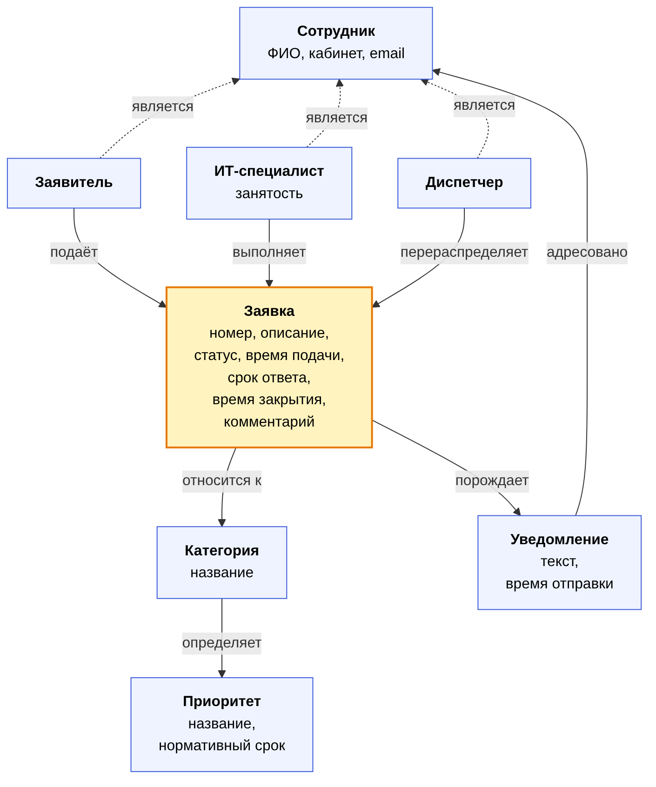

# Лабораторная работа 2. Пользовательский сценарий, онтологическая и инфологическая модели

**ФИО:** _Федосеев Александр Алексеевич_  
**Группа:** _ДИПРБ-41/2_  
**Вариант:** 14 — Внутренняя ИТ-служба

## Оглавление

- [1. Пользовательский сценарий](#1-пользовательский-сценарий)
- [2. Онтологическая модель](#2-онтологическая-модель)
- [3. Инфологическая модель](#3-инфологическая-модель)

---

## 1. Пользовательский сценарий

**Название:** обработка заявки сотрудника во внутреннюю ИТ-службу.

**Основной актор:** Заявитель — сотрудник предприятия.

**Участники:** Система, ИТ-специалист, Диспетчер, Сервис уведомлений.

**Цель:** устранение проблемы заявителя с подтверждением результата.

**Предусловие:** заявитель авторизован на портале ИТ-службы.

**Триггер:** у сотрудника возникла неисправность оборудования, сбой программного обеспечения или проблема с доступом к корпоративным сервисам.

**Основной ход выполнения**

1. Заявитель открывает на портале форму новой заявки.
2. Заявитель указывает категорию проблемы, вводит описание и отправляет заявку.
3. Система проверяет заполнение обязательных полей (категория и описание) и регистрирует заявку со статусом «Новая», фиксируя время подачи.
4. Система определяет приоритет заявки по её категории и рассчитывает срок ответа: 1 час для критичной заявки, 1 рабочий день для обычной.
5. Система назначает свободного ИТ-специалиста ответственным исполнителем и переводит заявку в статус «В работе». Исполнитель и заявитель получают уведомления.
6. ИТ-специалист выполняет работу по устранению проблемы и отмечает в системе её выполнение с комментарием о проделанной работе.
7. Система переводит заявку в статус «На подтверждении» и направляет заявителю запрос на подтверждение результата.
8. Заявитель проверяет результат и подтверждает устранение проблемы.
9. Система переводит заявку в статус «Закрыта» и фиксирует время закрытия.

**Исключительные ситуации**

- **Неполная заявка** (шаг 3). Система отклоняет отправку и указывает незаполненные обязательные поля. Заявитель дополняет данные и повторно отправляет заявку; сценарий продолжается с шага 3.
- **Нет свободного специалиста, обычный приоритет** (шаг 5). Система переводит заявку в статус «В очереди». Освободившийся специалист назначается на возвращённую ему заявку, если такая есть, иначе на первую заявку в очереди по времени подачи; сценарий продолжается с шага 5.
- **Нет свободного специалиста, критичный приоритет** (шаг 5). Система передаёт заявку диспетчеру с данными о загрузке специалистов. Диспетчер приостанавливает выполнение обычной заявки, которая возвращается в статус «В очереди», и назначает освободившегося специалиста на критичную. Заявка переходит в статус «В работе», исполнитель и заявитель получают уведомления; сценарий продолжается с шага 6.
- **Результат не принят** (шаг 8). Заявитель отклоняет подтверждение и в комментарии указывает, что не устранено. Система возвращает заявку тому же исполнителю. Если исполнитель свободен, заявка переходит в статус «В работе» и сценарий продолжается с шага 6. Если исполнитель занят другой заявкой, заявка переходит в статус «В очереди» с сохранением исполнителя и передаётся ему после освобождения.

**Результат (постусловие):** проблема устранена, заявка находится в статусе «Закрыта», в ней зафиксированы заявитель, исполнитель, время подачи и время закрытия.

---

## 2. Онтологическая модель

**Онтологическая модель** описывает предметную область через основные понятия, их свойства и смысловые связи между ними. Она не зависит от способа хранения данных: таблицы, ключи и количество связей задаются в инфологической модели. На основе онтологии строятся инфологическая модель и диаграмма классов.

Исходник: [diagrams/Ontology.mmd](diagrams/Ontology.mmd)

**Обозначения:** прямоугольник обозначает понятие, под названием перечислены его свойства. Пунктирная стрелка обозначает связь «является» и направлена от частного понятия к общему. Сплошная стрелка обозначает смысловую связь и подписана глаголом.

**Описание диаграммы.** Все участники процесса являются сотрудниками предприятия, поэтому Заявитель, ИТ-специалист и Диспетчер связаны отношением «является» с общим понятием Сотрудник, которое имеет свойства ФИО, кабинет и email. Заявитель подаёт Заявку. Заявка относится к Категории, которая обозначает тип проблемы. Категория определяет Приоритет с нормативным сроком ответа, поэтому срочность заявки зависит от типа инцидента. Заявку выполняет ИТ-специалист, у которого есть свойство «занятость», используемое при назначении исполнителя. При нехватке свободных специалистов для критичной заявки Диспетчер перераспределяет заявки. При назначении, выполнении работы и запросе подтверждения заявка порождает Уведомление, которое адресовано сотруднику. Ход обработки отражается в свойствах заявки: статусе, времени подачи, сроке ответа, времени закрытия и комментарии.

**Связи между понятиями**

| Связь | Вид | Смысл |
|---|---|---|
| Заявитель, Диспетчер, ИТ-специалист **являются** Сотрудником | «является» | роли наследуют свойства сотрудника |
| Заявитель **подаёт** Заявку | смысловая | заявитель сообщает о проблеме и принимает результат |
| ИТ-специалист **выполняет** Заявку | смысловая | ответственный за устранение проблемы (бизнес-правило 1) |
| Диспетчер **перераспределяет** Заявку | смысловая | при нехватке специалистов для критичной заявки |
| Заявка **относится к** Категории | смысловая | тип проблемы (бизнес-правило 3) |
| Категория **определяет** Приоритет | смысловая | срочность по типу проблемы (бизнес-правила 2 и 4) |
| Заявка **порождает** Уведомление | смысловая | о назначении, выполнении и запросе подтверждения |
| Уведомление **адресовано** Сотруднику | смысловая | информирование о ходе заявки |

---

## 3. Инфологическая модель

**Инфологическая модель** описывает структуру данных, которые хранит система: сущности, их атрибуты, ключи и связи с указанием количества (один к одному, один ко многим). Онтологическая модель описывает понятия предметной области и их смысл, а инфологическая определяет, какие данные и в каком виде нужно хранить, и служит основой для проектирования базы данных. Инфологическая модель изображается в виде ER-диаграммы.

Исходник: [diagrams/ER diagram.puml](diagrams/ER%20diagram.puml)

**Обозначения:** диаграмма построена в нотации IE. Прямоугольник обозначает сущность: над чертой указан первичный ключ, под чертой остальные атрибуты с типами данных. `<<PK>>` обозначает первичный ключ, `<<FK>>` внешний ключ, ссылающийся на первичный ключ другой сущности. Знаком `*` отмечены обязательные атрибуты. Концы линий показывают количество: `||` ровно один, `o|` ноль или один, `o{` ноль или много.

**Описание диаграммы.** Модель состоит из шести сущностей. Сущность Сотрудник хранит ФИО, кабинет, email и роль сотрудника («Сотрудник», «Диспетчер» или «ИТ-специалист»). Роль определяет права доступа к порталу. Любой сотрудник может подать заявку, поэтому Заявка ссылается на Сотрудника через внешний ключ `id_заявителя`. У заявки ровно один заявитель, сотрудник может подать любое количество заявок.

ИТ-специалисты внутренней службы являются сотрудниками предприятия, поэтому сущность ИТ-специалист использует в качестве ключа `id_сотрудника`, который одновременно является первичным ключом и внешним ключом на Сотрудника. Связь между ними один к одному: у специалиста ровно одна запись сотрудника, сотрудник может не быть специалистом. У сотрудника с ролью «ИТ-специалист» обязательно есть запись в этой сущности. Внешний ключ `id_исполнителя` в Заявке ссылается на ИТ-специалиста, поэтому исполнителем может быть назначен только специалист. Поле исполнителя в заявке одно, что обеспечивает правило «у заявки один ответственный». До назначения поле пустое. Если после отказа заявителя заявка ожидает занятого исполнителя, она находится в статусе «В очереди» с заполненным полем исполнителя.

Заявка хранит описание проблемы, статус («Новая», «В очереди», «В работе», «На подтверждении», «Закрыта»), время подачи, срок ответа, время закрытия и комментарий. Время закрытия заполняется после подтверждения заявителем. В комментарии исполнитель описывает выполненную работу, а заявитель указывает причину отказа. Заявка ссылается на Категорию через `id_категории`, Категория ссылается на Приоритет через `id_приоритета`. Приоритет хранит нормативный срок: 1 час для критичного и 8 рабочих часов (1 рабочий день) для обычного. Приоритет в заявке не дублируется и определяется по категории.

Уведомление связано с одной заявкой и одним получателем. Занятость специалиста не хранится: специалист занят, если за ним есть заявка в статусе «В работе». Для диспетчера отдельная сущность не нужна, так как собственных данных у него нет. Он отмечается ролью в Сотруднике, а перераспределение заявок отражается сменой исполнителя в Заявке.

**Связи между сущностями**

| Связь | Тип | Внешний ключ → первичный ключ | Смысл |
|---|---|---|---|
| ИТ-специалист **является** Сотрудником | 1 : 0..1 | ИТ-специалист.`id_сотрудника` → Сотрудник.`id_сотрудника` | специалист является сотрудником предприятия |
| Сотрудник **подаёт** Заявку | 1 : N | Заявка.`id_заявителя` → Сотрудник.`id_сотрудника` | у заявки один заявитель |
| ИТ-специалист **выполняет** Заявку | 0..1 : N | Заявка.`id_исполнителя` → ИТ-специалист.`id_сотрудника` | у заявки не более одного исполнителя (бизнес-правило 1) |
| Заявка **относится к** Категории | N : 1 | Заявка.`id_категории` → Категория.`id_категории` | категория обязательна (бизнес-правило 3) |
| Категория **определяется** Приоритетом | N : 1 | Категория.`id_приоритета` → Приоритет.`id_приоритета` | приоритет зависит от типа проблемы (бизнес-правила 2 и 4) |
| Заявка **порождает** Уведомление | 1 : N | Уведомление.`номер_заявки` → Заявка.`номер` | по заявке отправляется несколько уведомлений |
| Сотрудник **получает** Уведомление | 1 : N | Уведомление.`id_получателя` → Сотрудник.`id_сотрудника` | у уведомления один получатель |
